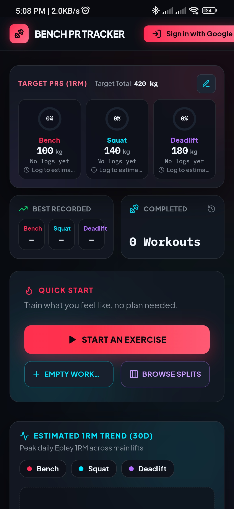
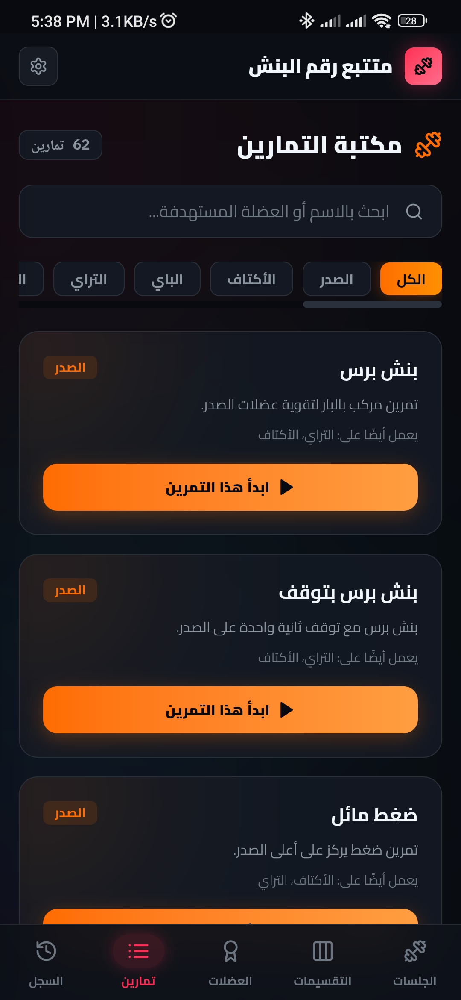
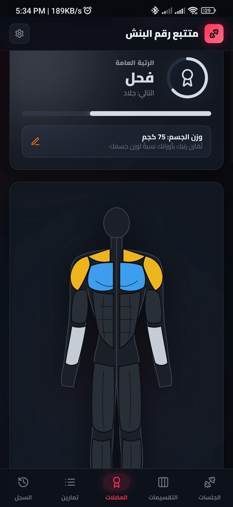
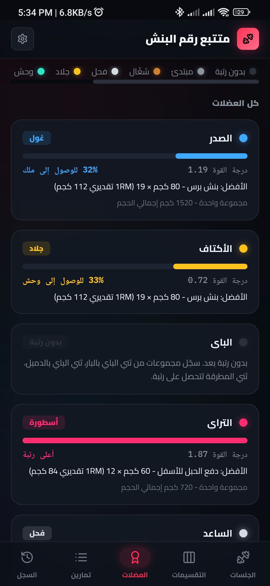
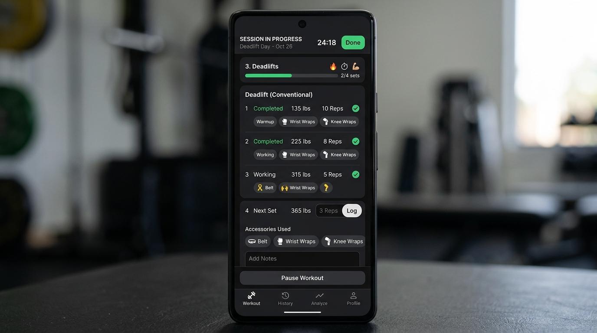

# BenchPR Tracker (React Web App & Android Wrapper)

A professional, high-performance strength training and powerlifting tracker featuring a sleek dark-mode aesthetic with vibrant red accents (`#FF2D55`), Google Authentication, real-time Firestore cloud sync, 1RM trend charts, workout calendar streaks, and comprehensive lifting accessories support (Belt, Wrist Wraps, Elbow Wraps, Knee Wraps, Knee Sleeves, Lifting Straps, and Chalk).

## App Screenshots

### Dashboard
Target PRs with progress rings, best recorded lifts, quick start, and the 30-day 1RM trend.



### Exercise Library
Searchable library with a pictogram for every exercise, muscle filters, and Arabic support.



### Muscle Ranks & Body Model
Interactive body model that colors each muscle group by its current rank.



### Muscle Rank Breakdown
Per-muscle strength scores, progress toward the next tier, and the best lift behind each rank.



### Active Workout Session & Gear Logging


## Key Features

- **Google Authentication & Cloud Persistence**: Sign in securely with your Google account to automatically record and sync all your workouts, preferences, and target PRs across sessions and devices via Firebase Firestore.
- **Target PRs (1RM)**: Manage your 1RM goals for **Bench Press**, **Squat**, and **Deadlift** with combined Target Total calculation, circular progress rings, and quick PR editor modals.
- **Lifting Accessories & Gear Support**: Attach any combination of lifting gear (*Belt*, *Wrist Wraps*, *Elbow Wraps*, *Knee Wraps*, *Knee Sleeves*, *Lifting Straps*, and *Chalk*) to each individual set.
- **30-Day Estimated 1RM Trend Charts**: Powered by Recharts with lift toggles, interactive tooltips, and time-to-target 1RM ETAs.
- **Workout Calendar & Training Streaks**: Interactive monthly calendar view highlighting training days, monthly active frequency, and workout streak tracking.
- **Training Splits**: 9 complete splits (PPL, Upper/Lower, Full Body, Bro Split, Arnold Split, PHUL, PPL + UL, 5x5) with expandable day breakdowns.
- **Interactive Muscle Ranks & Body Model**: Strength ranking engine comparing completed lifts against bodyweight across 13 muscle groups and 9 rank tiers (Unranked through Legend).
- **Exercise Library with Search**: Searchable, muscle-filterable exercise library with custom exercise creation.
- **Bilingual Support (English & Arabic RTL)**: Full English and Arabic translation engine with automatic RTL layout switching.
- **Automated GitHub Actions Releases**: CI/CD workflow that automatically builds web assets, compiles Android debug APKs, and publishes GitHub releases on pushes to `main`.

## Tech Stack

- **Frontend**: React 19, TypeScript, Tailwind CSS v4, Lucide Icons, Recharts.
- **Backend & Auth**: Firebase Authentication (Google Sign-In) & Cloud Firestore.
- **Mobile Packaging**: Android Gradle Plugin & System WebView wrapper.

## Development & Local Setup

```bash
# Install dependencies
npm install

# Run development server
npm run dev

# Build production assets
npm run build
```

## License

MIT License. Created for powerlifters and serious strength athletes.
